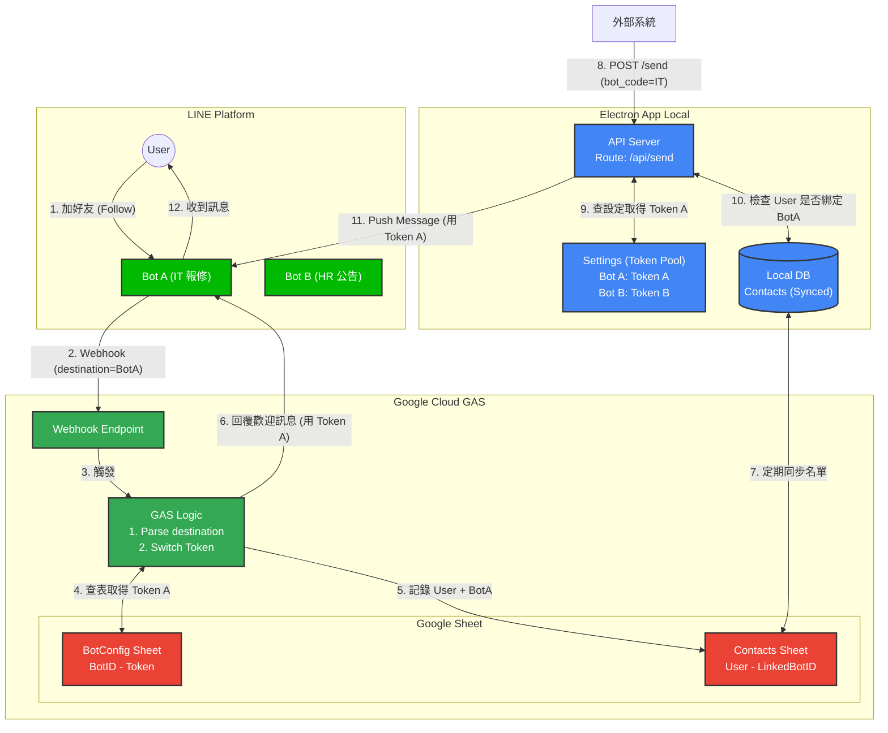
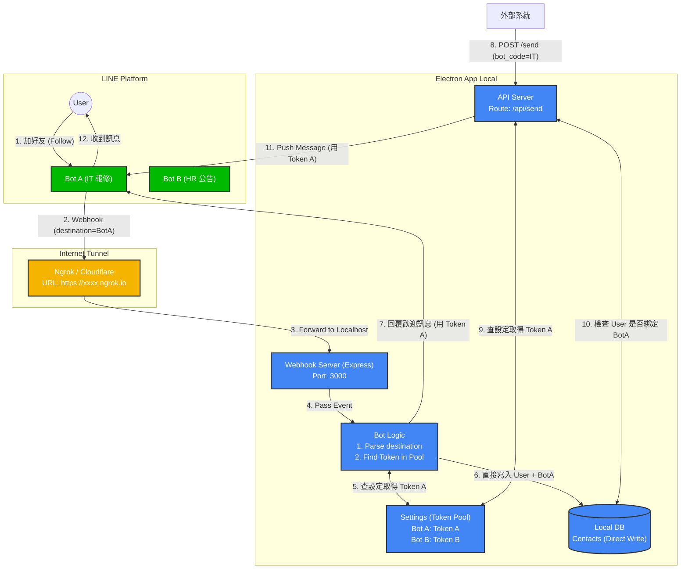

# 多帳號架構分析報告 (Multi-Account Architecture Analysis) v2

## 1. 目標 (Goal)

透過支援多個 LINE 官方帳號 (Official Accounts) 發送訊息，以利用多個「輕用量方案 (Light Plan)」的免費額度，降低整體營運成本。並精確統計用量與費用狀態。

## 2. 架構變更分析 (Architecture Changes)

### 2.1 Google Apps Script (GAS) 端

目前 GAS 負責將 LINE User ID 與員工資料綁定。

* **現狀**：單一 `CHANNEL_ACCESS_TOKEN`。
* **變更**：
  * 需要維護一個 **Token Pool** (帳號池)。
  * **Webhook 識別問題**：
    * LINE Webhook Event (Follow/Join) 會包含 `destination` (即 Bot 的 User ID)。
    * GAS 需新增 `BotConfig` Sheet (欄位：`BotID`, `AccessToken`, `Secret`)。
    * 收到 Webhook 時，先讀取 `destination`，再從 `BotConfig` 撈出對應的 Token 來呼叫 Reply API 或 Get Profile API。
  * **資料結構**：
    * `Contacts` Sheet 需新增 `LinkedBotID` 欄位，記錄該使用者是透過哪個 Bot 加進來的。

### 2.2 資料庫 (Electron Store)

* **現狀**：`settings.json` 只有一組 `channelAccessToken` 和 `lineChannelSecret`。
* **變更**：
  * 廢除單一欄位。
  * 新增 `accounts` 陣列 (Bot 帳號管理)：

    ```typescript
    interface BotAccount {
      id: string;          // UUID (系統內部 ID)
      name: string;        // 例如：IT 報修機器人
      lineBotId: string;   // 例如：@12345xyz (LINE Basic ID)
      channelAccessToken: string;
      secret: string;
      
      // [新增] 用量統計欄位
      quotaLimit: number;  // 每月免費額度 (例如 500)
      currentUsage: number;// 本月已用量 (可透過 API 同步)
      lastSyncTime: string;// 上次同步時間
    }
    ```

  * `contacts.json` (通訊錄) 需要新增欄位 `linkedBotIds`：

    ```typescript
    interface Contact {
      // ... 原有欄位
      linkedBotIds: string[]; // [新增] 紀錄此人加了哪些機器人 (例如 ["bot_uuid_1", "bot_uuid_2"])
    }
    ```

### 2.3 前端介面 (Frontend)

* **Settings.vue (設定頁)**：
  * **帳號管理列表**：CRUD 機器人帳號，並設定每個帳號的「每月額度」。
  * **用量儀表板**：顯示每個 Bot 目前的用量 (例如：Bot A: 450/500, Bot B: 100/500)。
* **Dashboard.vue (總覽頁)**：
  * 新增「多帳號用量總覽」，一眼看出哪個帳號快爆了。

### 2.4 後端邏輯 (Backend)

* **用量同步 (Quota Sync)**：
  * 實作 `syncQuota(botId)` 功能，呼叫 LINE API `GET /v2/bot/message/quota/consumption`。
* **發送邏輯 (Sending Logic)**：
  * **指定發送機器人 (Routing Strategy)**：
    * API `/api/send` 新增參數 `bot_code` (例如 `IT_BOT`)。
    * 若未指定，則需有「預設機器人」或「智慧路由」邏輯 (但建議優先採用明確指定，避免業務混淆)。
  * **檢查關係**：發送前檢查 `Contact.linkedBotIds`，確認目標用戶是否為該 Bot 的好友。
  * **檢查額度**：發送前檢查 `BotAccount.currentUsage < BotAccount.quotaLimit`。

## 3. 針對您問題的回答 (Q&A)

1. **帳號會根據業務拆分**：
   * **可行**。這是最推薦的做法 (例如 IT Bot, HR Bot)。系統中每個 Bot 可以設定不同的 `name` 和 `quotaLimit`。
   * **補充**：建議在發送 API 中強制指定 `bot_code`，確保「IT 通告」一定由「IT Bot」發送，避免使用者混淆。

2. **有沒有辦法記錄發了多少訊息 (人數 * 訊息數)**：
   * **有**。LINE API `GET /v2/bot/message/quota/consumption` 會回傳該帳號本月「已發送的總則數」。
   * **注意**：LINE 的計算方式是「發送對象數」。例如發給 10 人，就是 10 則。如果一次 Request 發給 10 人，也是算 10 則。我們的系統會以 API 回傳的數字為準。

3. **統計付費或是不付費發送**：
   * **邏輯**：
     * **免費**：當月累積發送量 <= 免費額度 (例如 500)。
     * **付費**：當月累積發送量 > 免費額度。
   * **實作**：系統會在 DB 記錄每個 Bot 的 `quotaLimit`。每次同步用量後，若 `currentUsage > quotaLimit`，介面上會顯示「超額 (付費中)」。

4. **每個人加過哪個 LINE 帳號需要統計**：
   * **實作**：在 `contacts.json` 中新增 `linkedBotIds` 陣列。
   * **資料來源**：
     * **Webhook (Follow Event)**：當用戶加好友時，Webhook 會收到 `destination` (Bot ID) 和 `userId`。系統會自動將該 Bot ID 加入該 User 的 `linkedBotIds` 列表。
     * **GAS 匯入**：GAS 的 `Contacts` Sheet 也需新增 `LinkedBotID` 欄位，匯入時一併同步。

5. **GAS 的 Webhook 識別問題**：
   * **問題**：GAS 只有一個 URL，多個 Bot 都打同一個 URL，如何區分？
   * **解法**：LINE Webhook Event Object 中包含 `destination` 欄位 (即 Bot 的 User ID)。GAS 程式碼需修改為：
     1. 解析 JSON 取得 `destination`。
     2. 根據 `destination` 去 `BotConfig` Sheet 查詢對應的 `Channel Access Token`。
     3. 使用該 Token 進行後續 API 呼叫 (Reply/GetProfile)。
   * **注意**：GAS 的 `doPost` 必須能動態切換 Token，不能再寫死單一 Token。

## 4. 遷移計畫 (Migration Plan)

由於資料結構有重大變更，需實作自動遷移邏輯：

1. **偵測舊版**：系統啟動時檢查 `settings.json` 是否有舊版 `channelAccessToken` 欄位。
2. **自動轉換**：
   * 建立一個新的 `BotAccount` (例如命名為 "Default Bot")。
   * 將舊的 Token/Secret 移入該 Account。
   * 將所有現有 `Contacts` 的 `linkedBotIds` 設為該 Default Bot 的 ID。
3. **清理**：移除舊版欄位，完成遷移。

## 5. 預估工時 (Estimated Effort)

* **資料庫與後端重構 (含用量 API 串接)**：約 6-8 小時
* **前端介面重寫 (含用量顯示)**：約 4-5 小時
* **GAS 修改與測試**：約 2-3 小時
* **整合測試**：約 2 小時
* **總計**：約 14-18 小時 (約 2-2.5 個工作天)

## 6. 實作注意事項 (Implementation Notes)

### 6.1 Token 雙重維護 (Double Maintenance)

由於 Electron (負責發送) 與 GAS (負責綁定) 是分開運作的，因此 **Channel Access Token** 必須在兩邊同時維護：

* **Electron**: 在「設定頁」新增/更新機器人時填入。
* **GAS**: 在 Google Sheet 的 `BotConfig` 分頁中填入。
* **注意**：若在 LINE Console 重新發行 Token，務必**同時更新**兩邊，否則會導致一邊能發送但另一邊無法綁定 (或相反) 的狀況。

### 6.2 Bot ID 格式區分

在填寫設定時需注意 ID 的區別：
* **LINE Basic ID (給人看的)**：格式為 `@1234xyz`。通常用於 Electron 介面顯示或搜尋加好友。
* **LINE User ID (給程式看的)**：格式為 `U` 開頭的 33 位字串 (例如 `U1234567890abcdef...`)。
  * **GAS 的 `BotConfig` 必須填寫此 ID**，因為 Webhook 的 `destination` 欄位是給這個 ID。
  * 此 ID 可在 LINE Developers Console > Messaging API > Bot information > **Bot user ID** 查到。

## 7. 架構方案對比 (Architecture Comparison)

為了讓您更清楚「混合架構」與「純本地架構」在**多帳號 (Multi-Account)** 情境下的運作差異，以下提供詳細的對比圖。

### 7.1 方案 A：GAS + Electron 混合架構 (推薦)

*   **多帳號處理方式**：
    *   **接收端 (GAS)**：透過 Webhook 的 `destination` 欄位辨識是哪個 Bot，並從 `BotConfig` Sheet 取得對應 Token。
    *   **發送端 (Electron)**：API 請求帶入 `bot_code`，從本地設定檔 (Settings) 取得對應 Token。
*   **優點**：GAS 負責「綁定關係」的高可用性，即使本地電腦關機，使用者也能加好友並被記錄。



### 7.2 方案 B：純本地架構 (Pure Local Architecture)

*   **多帳號處理方式**：
    *   **接收端 (Electron)**：所有 Bot 的 Webhook URL 都填寫同一個 ngrok URL。Electron 收到後解析 `destination`，從本地 Settings 查找 Token。
    *   **發送端 (Electron)**：同上，直接使用本地 Settings 的 Token。
*   **缺點**：若電腦關機，所有 Bot 的 Webhook 都會失敗 (無法加好友、無法自動回覆)。


